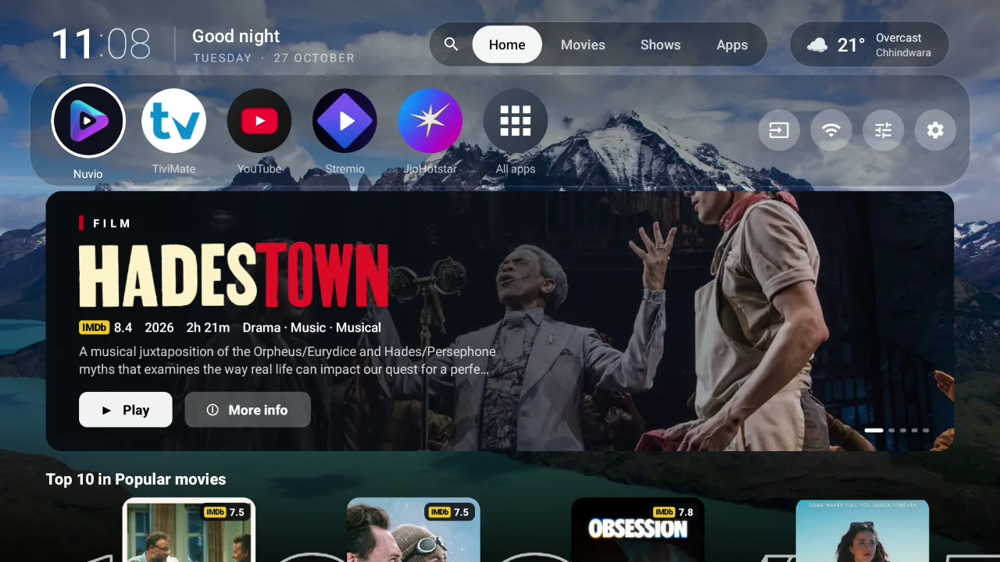
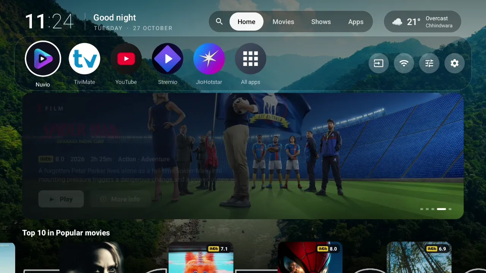

<p align="center">
  
</p>

<p align="center">
  <b>A fast, cinematic home screen for Android TV and Google TV.</b><br>
  Your apps, your films and your shows on one screen, built to stay light on 2 GB TVs.
</p>

<p align="center">
  <a href="https://github.com/HatriGt/flix-launcher/releases/latest"></a>
  <a href="https://github.com/HatriGt/flix-launcher/actions/workflows/build.yml"></a>
  
  
  
  <a href="LICENSE"></a>
</p>

<p align="center">
  <a href="#features">Features</a> ·
  <a href="#install">Install</a> ·
  <a href="#make-it-your-home-screen">Set as home</a> ·
  <a href="#settings">Settings</a> ·
  <a href="#build-from-source">Build</a> ·
  <a href="#faq">FAQ</a>
</p>

---

## Why Flix

Stock Google TV launchers are full of ads and heavy on cheap TVs. Flix replaces them with one calm, fast screen: your favourite apps on top, films and shows underneath, and a moving scenic background when you're not using it.

It's small (an APK of about 700 KB, with only RecyclerView, ZXing for the sign-in QR code and the profile installer as dependencies) and frugal: about 54 MB of memory on a 2 GB TV, because every icon is redrawn once into a GPU bitmap and artwork only loads for the card you're looking at.

## See it

<p align="center">
  
</p>

<p align="center">
  
</p>

<p align="center"><sub>Recorded on a Sony BRAVIA (Android TV 14, 2 GB) with the Landscapes aerial video background.</sub></p>

## Features

<table>
<tr>
<td width="50%" valign="top">

### 🏠 Home
- **Favourites row** of your apps, in the order you choose
- **Apps grid** on the home screen itself: no separate page, no wait
- **Colour glow** on the selected app, taken from its own icon
- Icon shape, size, app names and focus animation are all adjustable
- Home key always comes back to Flix, even on Google TV

</td>
<td width="50%" valign="top">

### 🎬 Films & shows
- **Featured carousel** of top-rated titles, on or off
- **Rows from any Stremio-compatible addon**; Cinemeta's popular lists are the default
- **Top 10** row and genre filter
- **Continue watching** from your Nuvio account, with progress bars
- **Trailers** play behind the selected title, with sound and start delay options
- OK opens the title in [Nuvio](https://nuvio.tv)

</td>
</tr>
<tr>
<td valign="top">

### 🌄 Backgrounds
- **About 270 aerial videos** (Apple TV, Amazon and community aerials): nature, sea, cities, space and art
- **Photo backgrounds** from the Bing archive: landscapes or cities
- Streamed when shown, never stored, so they take no space
- Fades into a full-screen scenery mode when idle

</td>
<td valign="top">

### ⏰ At a glance
- Clock in three styles, 12 or 24-hour
- Greeting, date and sunrise/sunset arc
- Weather and 3-day forecast (no API key; via wttr.in)
- **Searchable settings**: type "trailer" or "clock" and jump straight there
- Add addons from your phone over the home network

</td>
</tr>
</table>

## Install

1. Download `flix-launcher-<version>.apk` from the [latest release](https://github.com/HatriGt/flix-launcher/releases/latest).
2. Install it on the TV, either with a sideloading app (Downloader, Send Files to TV) or over adb:

   ```bash
   adb connect <tv-ip>:5555
   adb install flix-launcher-1.0.8.apk
   ```

**Needs:** Android TV / Google TV 9 (API 28) or newer. [Nuvio](https://nuvio.tv) is optional and only needed for opening titles and Continue watching.

## Make it your home screen

Google TV sends the Home button to its own launcher, whatever the default is. Flix handles this with a small accessibility service that only listens for the Home key.

1. On the TV, open **Settings → Accessibility → Flix Launcher** and switch it on.
2. *(Recommended)* Let Flix switch that service back on by itself after updates:

   ```bash
   adb shell pm grant com.flix.launcher android.permission.WRITE_SECURE_SETTINGS
   ```

That's it: press Home and Flix opens. Keep the stock Google TV home installed; Google TV shows a recovery screen when it's disabled.

## Settings

Open them from the settings button at the end of the top bar.

| Section | What you can change |
|---|---|
| **Home screen** | Icon shape and size, app names, colour glow, focus animation, All apps tile |
| **Movies & shows** | Nuvio account, addon rows and order, featured carousel, Continue watching, Top 10, genre, trailers (on/off, delay, sound), backdrop preview, poster size, hidden titles |
| **Clock & weather** | Clock style and format, greeting, date, sun arc, weather, forecast, units |
| **Wallpaper** | Photos, aerial video by category, or plain; shuffle, dimming, scene names, idle timer |
| **About** | Back up and restore every setting, favourite and addon row |

## Build from source

```bash
git clone https://github.com/HatriGt/flix-launcher.git
cd flix-launcher
./gradlew assembleRelease
# app/build/outputs/apk/release/app-release.apk
```

Requirements: JDK 17 and the Android SDK (compile SDK 35). The release build is minified with R8 and ships a baseline profile for a fast first start.

<details>
<summary><b>Project layout</b></summary>

| File | Role |
|---|---|
| `MainActivity.kt` | The home screen: dock, apps grid, rows, idle scenery |
| `AppRepository.kt` | Lists apps and redraws their icons once into compact GPU bitmaps |
| `MovieRows.kt`, `PosterAdapter.kt`, `Billboard.kt` | Film and show rows, cards and the featured carousel |
| `Catalog.kt`, `Addons.kt` | Stremio-compatible catalogue loading, cached for six hours |
| `NuvioAccount.kt`, `NuvioLoginActivity.kt` | Nuvio sign-in (QR code or email) and Continue watching |
| `Trailer.kt`, `TrailerService.kt` | Trailer playback in a separate process, so it never costs the home screen memory |
| `VideoFeed.kt`, `WallpaperFeed.kt`, `SceneryPlayer.kt` | Aerial video and photo backgrounds |
| `SettingsActivity.kt`, `FlixSettings.kt` | Searchable settings and their stored values |
| `HomeKeyService.kt`, `HomeGuard.kt` | Bringing the Home key back to Flix on Google TV |

</details>

## FAQ

<details>
<summary><b>Does Flix collect any data?</b></summary>

No. There are no analytics or ads. It talks only to the services it shows: your addons, Cinemeta, Nuvio (if you sign in), wttr.in for weather, the aerial video lists on GitHub, and YouTube for trailers.
</details>

<details>
<summary><b>What does OK on a title open?</b></summary>

Since 1.0.2, OK on a film opens Nuvio's stream list directly. A series opens its page so you can pick an episode; a Continue watching episode goes straight to its streams.
</details>

<details>
<summary><b>How much space do video backgrounds take?</b></summary>

None. They stream when shown and are never saved; only a small list of addresses is kept, refreshed weekly.
</details>

<details>
<summary><b>How do I move my settings to another TV or a fresh install?</b></summary>

**Settings → About → Back up settings** saves everything except your Nuvio sign-in to `Android/data/com.flix.launcher/files/backups`, with a copy in `Download/FlixLauncher`. On the other TV, copy the file into that same backups folder (for example `adb push flix-backup-*.json /sdcard/Android/data/com.flix.launcher/files/backups/`) and choose **Restore settings**.
</details>

<details>
<summary><b>How do I go back to the stock launcher?</b></summary>

Switch off Flix in **Settings → Accessibility**, or uninstall it.
</details>

## Acknowledgements

- [Aerial Views](https://github.com/theothernt/AerialViews) for its public aerial video lists
- [Cinemeta](https://v3-cinemeta.strem.io) and the Stremio addon protocol
- [npanuhin/Bing-Wallpaper-Archive](https://github.com/npanuhin/Bing-Wallpaper-Archive) for the photo archive
- [wttr.in](https://wttr.in) for weather

Flix Launcher isn't affiliated with Netflix, Google, Stremio or Nuvio. Film artwork, trailers and wallpapers belong to their owners and are loaded from their sources at run time; the app only bundles small preview thumbnails for the wallpaper list.

## License

[MIT](LICENSE) © HatriGt
